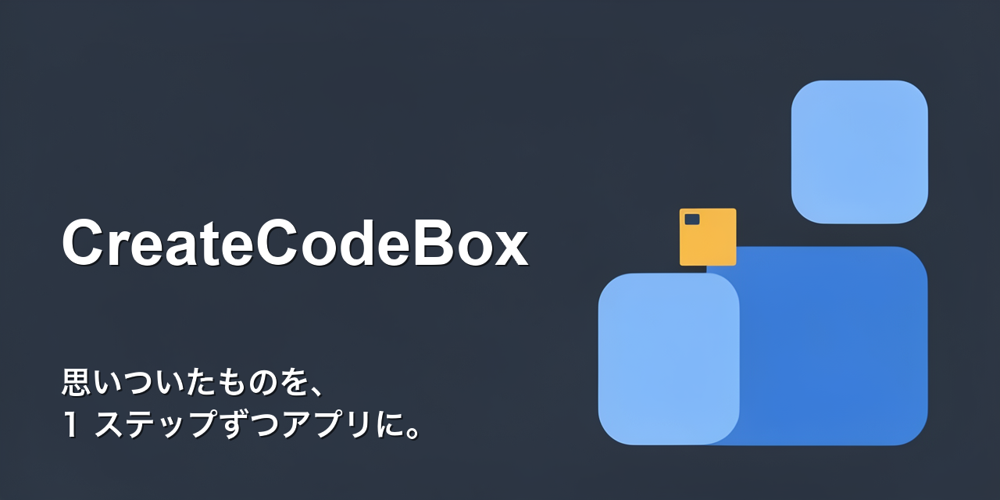
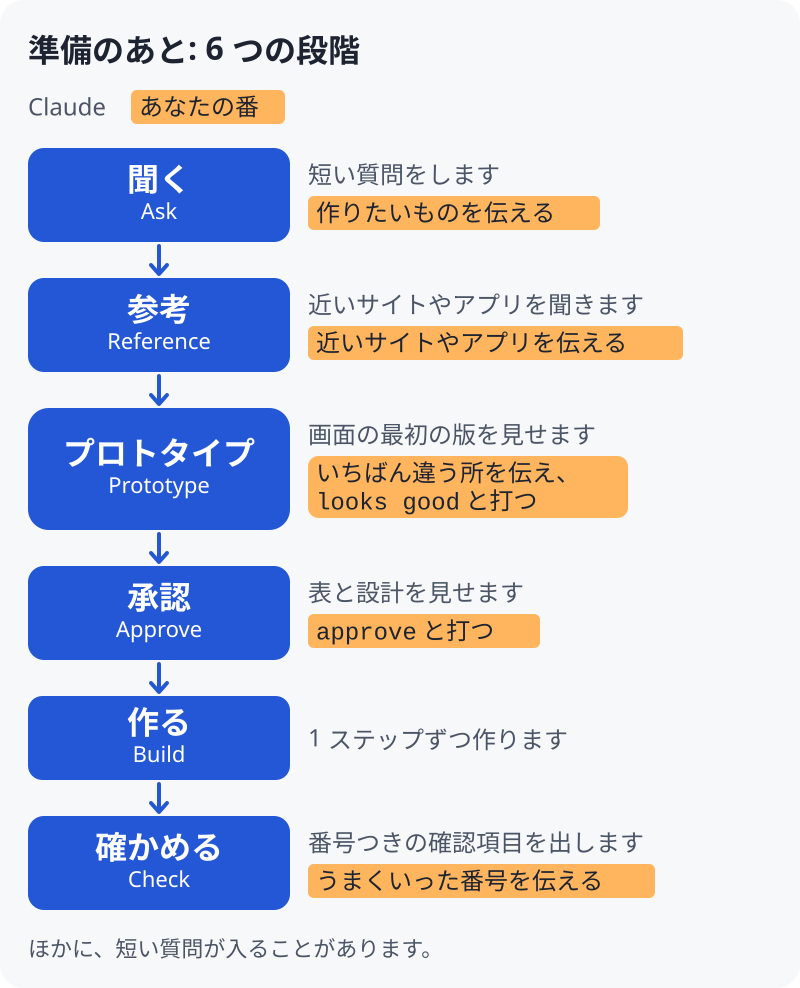

この日本語版は英語版（正本）の翻訳です。食い違いがあれば英語版が優先します。準備の手引き（Mac・Windows）は日本語版があります。そのほかの詳しい説明（docs の文書）は英語です。

<p align="center"></p>

#  CreateCodeBox

CreateCodeBox は、思いついたものを、画面を見ながら、小さなアプリにしていくワークスペース（この作業用のフォルダ一式）です。Claude Code を使い、1 ステップずつ進めます。アプリを作る前に、アプリの画面の最初の版を見られます。その最初の版がプロトタイプで、本物のアプリではありません。Claude には、あなたが作りたいものに近いサイトやアプリを知っているかを尋ねるよう指示してあります。参考のサイトやアプリを伝えたときは、それに似た配置と流れになります。中身は作り物のデータです。

現状: お試し版です。自分のパソコンで動く小さなアプリを作る使い方を想定しています。つまずいたときは、質問に答えてくれる人が近くにいると助かります。

ここまでに確かめたこと: Mac での試験の実行が 3 回です。どれも、権限の確認は切って行い、最初の絵が出る所までです。作る段階、Windows、ふつうの使い方、手順 3 の 1 文での始め方は、まだ確かめていません。詳しくは [docs/details.md](docs/details.md)（英語）にあります。

CreateCodeBox は、アプリのコード（`src/`）を、あなたが承認するまで書かないように作ってあります。コマンドを覚えなくても進められます。専門の言葉が出たら 1 文で説明するよう、Claude に指示してあります。何も指定しなければ、作るアプリは、ブラウザで開く小さな Web ページです。

<picture>
  <source media="(prefers-color-scheme: dark)" srcset="docs/img/flow-ja-dark.svg">
  
</picture>

「あなたの番」と書かれた色つきの枠が、あなたが答える所です。残りは、Claude が進めるよう指示してあります。

始めるには、次の 6 つの手順で進めます。

1. **Claude Code を入れます。** Anthropic の[公式の案内](https://code.claude.com/docs/en/overview)に従ってください。サインインのしかたと料金は、その案内に説明があります。`git` と Python 3 も要ります。3.8 以上で、私たちが試したのは 3.9 です。詳しくは[こちら](docs/details.md)を見てください。手引きは、[Mac](docs/setup-mac.ja.md)（[English](docs/setup-mac.md)）と [Windows](docs/setup-windows.ja.md)（[English](docs/setup-windows.md)）にあります。
2. **ターミナルを開いて、`claude` と打ちます。** ターミナルは、コマンドを打つためのウィンドウです。Mac: command キーとスペースキーを同時に押し、「ターミナル」と入力して、return キーを押します。Windows: Git Bash を開きます。Git Bash は Git に付いてきます。Windows の手引きのページを見てください。そのあと `claude` と打って、Enter キー（Mac では return キー）を押します。これで Claude Code が起動します。初回は、Claude Code がサインインを求めることがあります。
3. **次の 1 文を、Claude Code に貼り付けます。** 貼り付けたら、Enter キーを押します。貼り付けは、Mac では command + V、Windows では Shift + Insert か右クリックです。

```
Set up CreateCodeBox from https://github.com/atasino/CreateCodeBox. First read the whole file https://raw.githubusercontent.com/atasino/CreateCodeBox/main/BOOTSTRAP.md with curl (a web summary is not enough), then follow it.
```

   英文は、そのまま貼り付けます。上の英文にある 2 つのアドレスは、このリポジトリ（GitHub 上にあるコードの置き場）のものです。このリポジトリをコピーしたものを使うときだけ、2 つのアドレスにある `atasino/CreateCodeBox` を、そのコピーの持ち主と名前に置き換えてください。下の `curl` と `git clone` のコマンドも、同じように置き換えてください。持ち主と名前は、そのコピーのページをブラウザで開き、アドレス欄から写してください。ほかのページのアドレスは使わないでください。

   この 1 文は、設定の手順（`BOOTSTRAP.md`）を `curl` で取ってくるよう、Claude Code に求めます。`curl` は、Web のアドレスからファイルを取ってくる小さな道具です。取ってくる前に、Claude Code が `curl` を使う許可を求めてくることがあります。これは想定どおりです。許可を求める画面に出るコマンドは、次の形のはずです。

   `curl -sL https://raw.githubusercontent.com/atasino/CreateCodeBox/main/BOOTSTRAP.md`

   `curl` のすぐ後ろの `-sL` は、`-s` や `-fsSL` になることがあります。それ以外に違う所はないはずです。この形のコマンドは、`BOOTSTRAP.md` を取ってきて Claude Code に見せるだけです。ほかに違う所がある場合、たとえば `|`（パイプ）や `>` の記号が付いていたり、アドレスが別のものだったりするときは、許可しないでください。許可しなくても、この手順が止まるだけです。そのときは、下の 3 行を自分で打つこともできます。

   または、次の 3 行を自分で打ちます。先に、`/exit` と打って Claude Code を終了するか、2 つ目のターミナルのウィンドウを開きます。そのあと、ターミナルに 1 行ずつ打ちます。Windows の Git Bash では、[Windows の手引き](docs/setup-windows.ja.md)を見てください。

```
git clone https://github.com/atasino/CreateCodeBox.git ~/CreateCodeBox
cd ~/CreateCodeBox
claude
```

   Git からサインインを求められたり、リポジトリが見つからないと表示されたりしたときは、リポジトリのアドレスが違っているのかもしれません。[A step did not work](https://github.com/atasino/CreateCodeBox/issues/new/choose) のフォームに、画面に出た表示を書いてください。

   3 行を打ったときは、Claude Code はもう、新しく作った `CreateCodeBox` のフォルダで起動しています。Claude Code から、このフォルダを信頼してよいかを聞かれます。1 行目のアドレスを信頼できるなら、yes と答えます。コマンドを実行してよいかの許可も求められることがあります。質問は、1 つずつ読んでから答えてください。そのあと、手順 4 は飛ばして、手順 5 に進みます。

4. **1 文を貼り付けたときだけ、Claude の案内に従います。** 3 行を打ったときは、手順 5 に進みます。

   Claude には、CreateCodeBox のコピーを、ホームフォルダ（あなたのユーザー名のフォルダ）の中の `CreateCodeBox` というフォルダに置くようにしてあります。そのあと、打つ 2 行を見せるようにしてあります。

   先に、`/exit` と打って Claude Code を終了するか、2 つ目のターミナルのウィンドウを開きます。そのあと、2 行を打ちます。そのフォルダへ移る `cd` と、`claude` です。Windows の Git Bash では、フォルダは `~/CreateCodeBox` です。

   Claude が今作った `CreateCodeBox` のフォルダについて、Claude Code が信頼してよいかを聞いてきたら、yes と答えます。コマンドを実行してよいかの許可も求められることがあります。質問は、1 つずつ読んでから答えてください。

5. **作りたいアプリを Claude に伝えます。** Claude Code が動いているターミナルに打ちます。例: `簡単な家計簿アプリを作りたいです。` Claude には、あなたが書いた言語で答えるよう指示してあります。Claude は短い質問をして、そのあと、プロトタイプをブラウザで見せます（開けないときは、開くファイルを教えます）。
6. **アプリを開きます。** Claude が完成したと伝えたら、Claude が教える場所にある `index.html` をダブルクリックして開きます。

## ここでの「完成」

Claude が完成したと伝えたとき、手元にできているのは、あなたのパソコンで開く小さな Web ページです。何も指定しなければ、そうなります。

スマホで使う、ほかの人に使ってもらう、といったことには、追加の作業が要ります。たとえば、ウェブのホスティングサービス（アプリをネットで動かし続けてくれるサービス）に置く作業です。CreateCodeBox は、ホスティングの手順までは案内しません。GitHub にコードの公開用のコピーを作る手伝いはできます。ただし、それはコードを見せるもので、ほかの人のためにアプリを動かすものではありません。GitHub の部分は、本物の GitHub では、まだ試していません。

## あとで続きから始める

1. ターミナルで `cd ~/CreateCodeBox` と打ち、続けて `claude` と打ちます。（Windows の Git Bash でも、同じ 2 行です。）
2. Claude に「続き」と伝えます。アプリが 1 つだけなら、Claude がそのアプリの続きから始めるよう指示してあります。
3. 作ったものだけ見るときは、Finder（Mac）かエクスプローラー（Windows）で、ホームフォルダの中の `CreateCodeBox/projects/<名前>/src` を開き、`index.html` をダブルクリックします。`<名前>` は、`projects/` の中にある、あなたのアプリのフォルダの名前です。
4. 設計を承認したあとは、Claude は、プロジェクトごとに「残っていること」の一覧をつけるよう指示してあります。あなたの要望・困りごと・やることを、日付つきで書きます。承認の前の答えは `PROJECT.md` に入ります。一覧は `CreateCodeBox` フォルダに保存されるので、新しい会話でも続きから拾えます。「何が残っている？」と聞くと一覧が、「予定を見せて」と聞くと予定表が出ます。予定は、ブラウザで開けるページにもなっています。`CreateCodeBox` フォルダの中の `projects/schedule.html` です。このページは自動で読み込み直されます。

## できること

- 短い質問を 1 つずつして、作りたいものに近いサイトやアプリがあるかも聞きます。
- プロトタイプを見せ、そのあと設計を見せます。アプリのコードは、あなたが承認するまで書かれないように作ってあります。
- 鍵（API キーなど）とパスワードをチャットに出さないように作ってあります。

## 進み方: 6 つの段階

1. **聞く（Ask）。** 何を作りたいですか。誰のためですか。自分だけのためですか、ほかの人にも見せますか。「分かりません」と答えて大丈夫です。最初の絵を見るまでに、ふつうは、短い質問に 3 つほど答えます。
2. **参考（Reference）。** 近いサイトやアプリを知っていたら、その名前かリンクを Claude に伝えてください。気に入っている所と、自分のものでは変えたい所も伝えます。「ありません」と答えて大丈夫です。
3. **プロトタイプ（Prototype）。** Claude が、参考にしたサイトやアプリと、見た目や流れが似たプロトタイプを見せます。参考が無いときは、代わりに大まかな最初の絵を見せます。思っていたものと、いちばん違う所を伝えてください。Claude が直します。直したものでよければ、次の言葉をそのまま打ちます: `looks good` または「この形で」。打つと、プロトタイプが設計になります。「いい感じです」のように、短く前向きな自分の言葉で答えたときは、その答えを「この形で」として記録するかどうか、1 回だけ聞くよう Claude に指示してあります。記録してよければ、次のメッセージで「はい」と返してください。
4. **承認（Approve）。** Claude が、表と、プロトタイプから育てた設計をあわせて見せます。表には、アプリに入れる情報と出てくる結果を載せます。その表と設計をまとめて承認するときは、次の言葉をそのまま打ちます: `approve` または「承認します」。ここでも、短く前向きな自分の言葉で答えたときは、その答えを承認として記録するかどうか、1 回だけ聞くよう Claude に指示してあります。記録してよければ、次のメッセージで「はい」と返してください。
5. **作る（Build）。** Claude は 1 ステップずつ作ります。Claude には、各ステップを実行して何が起きたかを書き残してから、そのステップが済んだと言うよう求めてあります。
6. **確かめる（Check）。** Claude が、番号つきの確認項目を出します。1 つずつ試して、うまくいったかどうかを番号で伝えます。何を確かめ済みで、何が未確認かは、Claude が伝えます。

あなたに入力をお願いするのは、主にこの 6 つの段階です。Claude が短い質問を少し足すことや、Claude Code がフォルダの信頼を聞くことがあります。残りは Claude が決め、仮に決めたものには仮だと分かる印を付けるよう指示してあります。

## どこに何があるか

作るアプリごとに、`projects/` の中に専用のフォルダができます。

- `PROJECT.md` に、あなたの答えが入ります。
- `design/` に、Claude があなたのために作った絵と表が入ります。
- `src/` に、Claude が作ったものが入ります。開くのは `src/index.html` というファイルです。
- `knowledge/` に、あなたが Claude に渡したファイルとメモが入ります。

## 安全について（要点）

- **鍵とパスワード。** ワークスペースは、鍵（API キーなど）とパスワードをチャットに出さないように作ってあります。アプリが鍵を必要とするときは、別のターミナルのウィンドウに打ちます。鍵は、このワークスペースの外のフォルダ `~/.createcodebox` に保存されます。
- **あなたのコード。** Claude には、コードを書く前にあなたの承認を求めるよう指示してあります。承認があるまで、ワークスペースはコードを書く段階に進ませません。すでに持っているコードを使う場合に備えた設定があります。持ち込んだコードの `src/` フォルダの中にある `CLAUDE.md` ファイルは、ワークスペースが読み込まないようにしてあります。読み込まれないことを確かめたのは、`src/` の直下にある `CLAUDE.md` だけです（[docs/details.md](docs/details.md) を見てください）。
- **GitHub。** 作業の保存（セーブ）は、あなたのパソコンの中にだけ残ります。Claude には、あなたが GitHub のアドレスを渡してバックアップ（GitHub 上の非公開のコピー）を頼むまで、GitHub に何も送らないよう指示してあります。公開するときは、あなた自身が、次の言葉をそのまま打ちます: `publish` または「公開します」。公開とは、誰でも見られるコピーを作ることです。
- **限界。** この仕組みは、承認の前にコードを書くなど、段階を飛ばすことを難しくします。すべてを止められるわけではありません。Claude が実行するコードは、この仕組みをすり抜けることがあります。Claude が書き残した「実行した内容」のメモについて、本当かどうかを、ワークスペースは確かめません。詳しくは [docs/security.md](docs/security.md) にあります。

## Codex で使う（試験中）

CreateCodeBox は、Codex（ターミナルでコードを書くときに使う、OpenAI の道具）でも動かせます。これは**試験中**の機能です。一部しか試しておらず、Claude Code 版と比べても、確かめた範囲が狭いです。

1. Codex を入れて、サインインします。OpenAI の案内に従ってください。上の手順 1 と同じく、`git` と Python 3（3.8 以上）も要ります。
2. ターミナルを開き（上の手順 2 を見てください）、`codex` と打って Enter キーを押します。そのあと、次の 1 文を Codex に貼り付けます。

```
Set up CreateCodeBox by following BOOTSTRAP.codex.md in https://github.com/atasino/CreateCodeBox
```

3. Codex を閉じるか、ターミナルをもう 1 つ開きます。そのあと、ターミナルで、Codex が示すことになっている 2 行を打ちます。`cd` の行は、ターミナルを新しいフォルダへ移します。`codex` の行は、そのフォルダで Codex を起動します。
4. **hooks を信頼します。この手順は飛ばさないでください。** このワークスペースの点検は、Codex の hooks で動いています。hooks は、ファイルを変える前など、決まった場面で Codex が動かす小さなプログラムです。Codex がフォルダを信頼するか聞いてきたら、さきほど作った `CreateCodeBox` のフォルダのときだけ yes と答えます。そのあと Codex の中で `/hooks` と打ち、CreateCodeBox の hooks を見て、信頼します。`codex exec`（1 つのコマンドで Codex を動かす方法）で試したときは、信頼していない hooks を、Codex は何も表示せずに飛ばしました。点検が動いていないときは止まるよう、指示のファイル `AGENTS.md` で Codex に頼んであります。ただ、これはお願いであって、強制する仕組みではありません。

実際の Codex で、このワークスペースを動かして確かめました。Mac の codex-cli 0.154.0 を使い、`codex exec` で行いました。Codex が実行の前に確認を求める設定は、切って試しました。確かめた事は次のとおりです。

- 設計が承認される前は、Codex が `src/`（アプリのコードを置くフォルダ）に書き込もうとしても止めること。
- 私たちが `approve` というメッセージを送ったら、それを記録すること。
- そのあとは、Codex が `src/` に書き込めるようにすること。
- 設計が変わったら、`src/` を再び書き込めない状態に戻すこと。
- 秘密の鍵らしい文字列を、Codex がファイルに書こうとしても止めること。
- 新しいセッションでも、作業がどこまで進んだかを覚えていること。

**確かめていない事:**

- Codex の画面での信頼の手順。フォルダは、Codex の設定で先に信頼済みにしました。hooks は、信頼の手順を飛ばす設定で動かしました。
- 承認の前の設計の手順。この手順に使うファイルは、Codex ではなく、私たちが書きました。
- Windows。
- 本物の MCP サーバーの道具（MCP は、ネット上のサービスの道具を足す方法です）。
- 1 文から完成までの全体の流れ。

Claude Code では、設計する役、作る役、確かめる役を、別々の補助の AI が受け持ちます。この Codex 版は、補助の AI を使いません。1 つの AI が、設計し、作り、確かめる作業を順に行います。確かめる段階は、同じ AI がもう一度見直すだけで、独立したレビューではありません。[強化モード（hardened mode）](docs/security.md#hardened-mode)は、より厳しい設定で、Claude Code でしか使えません。この試しの記録は [docs/codex-notes.md](docs/codex-notes.md) にあります。

## 任意: Gakaso

Gakaso は、CreateCodeBox と同じチームが作っているデザインツールです。無料のプランがありますが、月ごとの上限があります。デザインを見ながら直したいと頼んだとき、Claude が 1 度だけ勧めることがあります。断ってかまいません。Gakaso が無くても、ワークスペースは使えます。

## もっと知る

- [仕組みと、確かめたこと](docs/details.md)
- [安全の詳細](docs/security.md)
- [自分のリポジトリで使う、または開発者として使う](docs/for-developers.md)
- [Mac での準備](docs/setup-mac.ja.md)（[English](docs/setup-mac.md)） · [Windows での準備](docs/setup-windows.ja.md)（[English](docs/setup-windows.md)）
- 仕組みの図: ブラウザで `ws/learn/overview.html` を開いてください。
- 英語版（正本）: [README.md](README.md)

うまくいかないときは、操作の間違いとは限りません。この手順に不備があるのかもしれません。[A step did not work](https://github.com/atasino/CreateCodeBox/issues/new/choose) のフォームに、画面に出た表示を書いてください。

質問は [Discussions](https://github.com/atasino/CreateCodeBox/discussions) に書いてください。

CreateCodeBox は Anthropic の公式製品ではありません。

ライセンス: MIT です。[LICENSE](LICENSE) を見てください。
