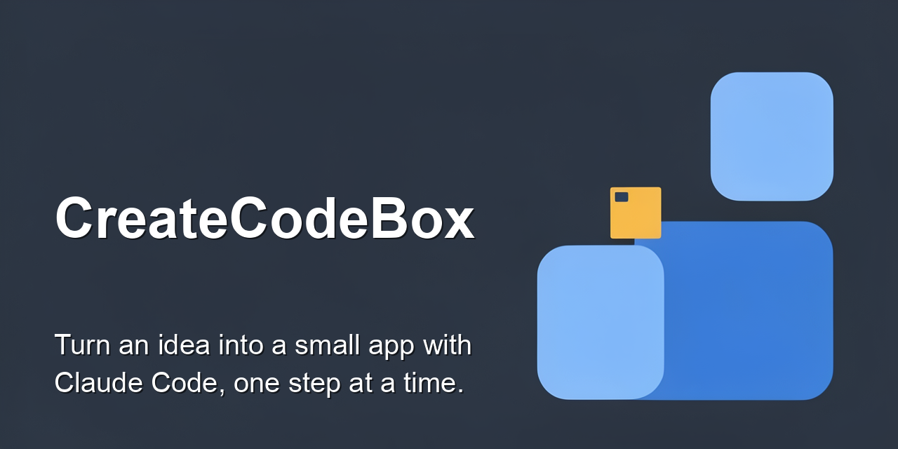
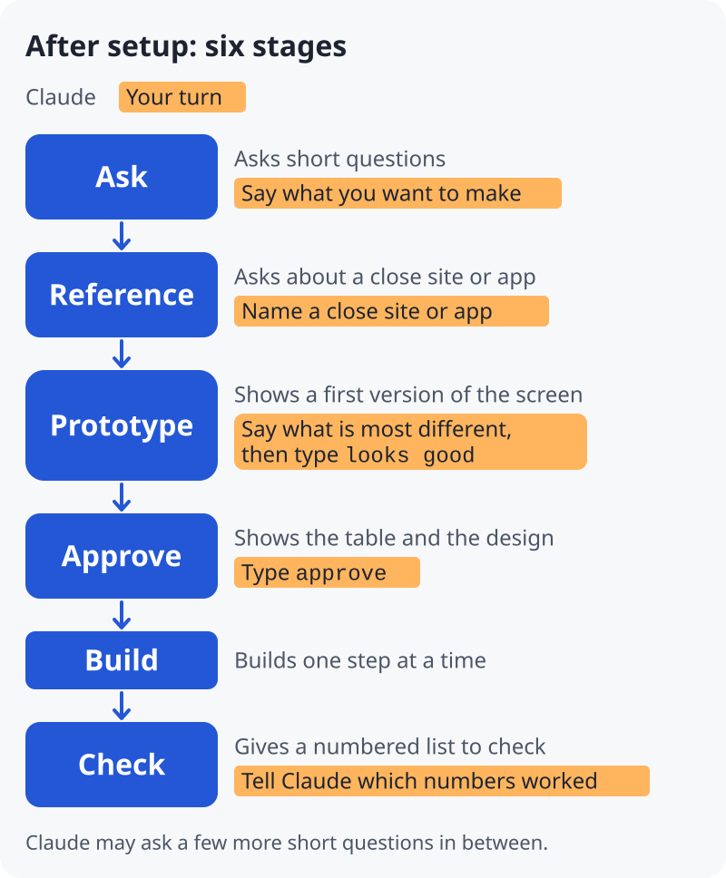

<p align="center"></p>

#  CreateCodeBox

CreateCodeBox is a workspace for turning an idea into a small app with Claude Code, one step at a time. Before Claude builds the app, you see a first version of its screen. The first version is a prototype, not the real app. Claude is told to ask about a site or app that is close to what you want. If you name a site or app, the prototype has a similar layout and flow to it. It is filled with made-up data.

Status: preview. It is meant for small apps that run on your own computer. If you get stuck, it helps to have someone nearby who can answer questions.

What we have checked so far: three test runs on a Mac, with permission prompts turned off. They went as far as the first picture. We have not checked the build stage, Windows, normal sessions, or the one-sentence start in step 3. Details: [docs/details.md](docs/details.md).

CreateCodeBox is built so that the app's code (in `src/`) is not written until you approve. You do not need to remember commands, and Claude is told to explain each technical word in one short sentence. By default, the app is a small web page that opens in your browser.

<picture>
  <source media="(prefers-color-scheme: dark)" srcset="docs/img/flow-en-dark.svg">
  
</picture>

The colored boxes marked "Your turn" are where you answer. Claude is told to do the rest.

To start, follow the six steps below.

1. **Install Claude Code.** Follow Anthropic's [official guide](https://code.claude.com/docs/en/overview). The guide explains how to sign in and what it costs. You also need `git` and Python 3 (3.8 or newer; we tested 3.9, see [details](docs/details.md)). Help: [Mac](docs/setup-mac.md), [Windows](docs/setup-windows.md).
2. **Open Terminal and type `claude`.** Terminal is the window where you type commands. Mac: press the Command key and the Space bar together, type "Terminal", press Enter. Windows: open Git Bash (it comes with Git; see the Windows help page). Then type `claude` and press Enter. This starts Claude Code. The first time, Claude Code may ask you to sign in.
3. **Paste this one sentence** into Claude Code, and press Enter. (Mac: Command + V. Windows: Shift + Insert, or right-click.)

```
Set up CreateCodeBox from https://github.com/atasino/CreateCodeBox. First read the whole file https://raw.githubusercontent.com/atasino/CreateCodeBox/main/BOOTSTRAP.md with curl (a web summary is not enough), then follow it.
```

   Paste the sentence as it is. The two addresses in it belong to this repository (the place on GitHub that holds this code). Only if you use a copy of it on GitHub (a fork), replace `atasino/CreateCodeBox` with the owner and name of that copy in both addresses, and also in the `curl` command and the `git clone` line below. To find the owner and name, open the page of that copy in your browser and copy them from the address bar. Do not use the address of another page.

   The sentence asks Claude to get the setup steps (`BOOTSTRAP.md`) with `curl`, a small tool that gets a file from a web address. Before it does, Claude Code may ask your permission to run `curl`. That is expected. The command on that screen should look like this:

   `curl -sL https://raw.githubusercontent.com/atasino/CreateCodeBox/main/BOOTSTRAP.md`

   The `-sL` right after `curl` may be `-s` or `-fsSL` instead. Nothing else should be different. A command like that only gets `BOOTSTRAP.md` and shows it to Claude. If anything else is different (for example a `|` (pipe) or `>` sign, or another address), say no. Saying no only stops this step. You can then type the 3 lines below instead.

   Or type these 3 lines yourself. First close Claude Code (type `/exit`), or open a second Terminal window. Then type the lines one at a time, in Terminal. In Git Bash on Windows, see the [Windows help](docs/setup-windows.md).

```
git clone https://github.com/atasino/CreateCodeBox.git ~/CreateCodeBox
cd ~/CreateCodeBox
claude
```

   If Git asks you to sign in, or says the repository was not found, the repository address may be wrong. Use the form [A step did not work](https://github.com/atasino/CreateCodeBox/issues/new/choose) and tell us what you saw.

   If you typed the 3 lines, Claude Code is now running in your new `CreateCodeBox` folder. When Claude Code asks you to trust this folder, answer yes if you trust the address in the first line. Claude Code may also ask permission to run commands. Read each question first. Then skip step 4 and go to step 5.

4. **Only if you pasted the sentence: follow what Claude shows you.** (If you typed the 3 lines, go to step 5.)

   Claude is meant to put a copy of CreateCodeBox in a folder named `CreateCodeBox` in your home folder (the folder with your user name). Then it is meant to show you two lines to type.

   Close Claude Code first (type `/exit`), or open a second Terminal window. Then type the two lines: `cd` to that folder, then `claude`. (In Git Bash on Windows, the folder is `~/CreateCodeBox`.)

   If it is the `CreateCodeBox` folder that Claude just made, answer yes when Claude Code asks you to trust it. Claude Code may also ask permission to run commands. Read each question first.

5. **Tell Claude what you want to make.** Type it in the window where Claude Code is running. For example: `I want to make a simple budget tracker.` Claude is told to answer in the language you write in. Claude asks short questions, then shows you a prototype in your browser (or tells you the file to open).
6. **Open the app.** Later, when Claude says it is ready, open the file it names. Claude gives you the exact path. The file is called `index.html`. Double-click it.

## What "done" means here

When Claude says the app is ready, you have a small web page that opens on your own computer. That is what you get by default.

To use it from a phone, or to let other people use it, you need more work. One example is putting it on a web hosting service. CreateCodeBox does not guide you through hosting. It can help you make a public copy of the code on GitHub. That shares the code. It does not run the app for others. We have not tested the GitHub part on real GitHub yet.

## Pick up where you left off

1. In Terminal, type `cd ~/CreateCodeBox`, then `claude`. (In Git Bash on Windows, the same two lines work.)
2. Tell Claude `continue`. If you have only one project, Claude is told to pick it up by itself.
3. To see only what you made, open the file `CreateCodeBox/projects/<name>/src/index.html` in Finder (Mac) or File Explorer (Windows) and double-click it. `<name>` is the name of your project's folder inside `projects/`.
4. After you approve the design, Claude is told to keep a list of what is left in each project. It holds your wishes, problems, and to-dos, with their dates. Before that, your answers go into `PROJECT.md`. The list is saved in the `CreateCodeBox` folder, so a new session can pick it up. Ask "what is left?" to see the list, or "show the schedule" to see the dates. The schedule is also a page you can open in a browser: `projects/schedule.html` (inside the `CreateCodeBox` folder). The page updates by itself.

## What it does

- It asks short questions, one at a time, and asks about a site or app that is close to what you want.
- It shows a prototype, then a design.
- It is built to keep keys and passwords out of the chat.

## How it goes: six stages

1. **Ask.** What do you want to make? Who is it for? Is it just for you, or for others? "I don't know" is a good answer. Before the first picture, you usually answer about three short questions.
2. **Reference.** If you know a site or app that is close, tell Claude its name or link. Say what you like about it, and what should be different. "None" is fine.
3. **Prototype.** Claude shows a prototype with a similar layout and flow to your reference. If you have no reference, Claude shows a rough first picture instead. You say what is most different from what you want. Claude fixes it. When you type `looks good`, the prototype becomes the design. You can also answer with a short, positive reply in your own words, such as "Looks great". Then the workspace tells Claude to ask you once whether to record that as `looks good`. Reply `yes` in your next message to record it.
4. **Approve.** Claude shows a table of what goes in and what comes out. You type `approve` for that table and the design together. You can also answer with a short, positive reply in your own words. Then the workspace tells Claude to ask you once whether to record that as `approve`. Reply `yes` in your next message to record it.
5. **Build.** Claude builds one step at a time. Claude is asked to run each step and write down what happened before it says the step is done.
6. **Check.** Claude gives you a numbered list of things to check. You try each one and tell Claude, by number, which ones worked. Claude tells you what is checked and what is not.

You are asked for your own input mainly at these six stages. Claude may ask a few more short questions, and Claude Code may ask you to trust a folder. Claude is told to decide the rest and to mark each guess as tentative.

## Where things are

Each thing you make has its own folder inside `projects/`:

- `PROJECT.md` has your answers.
- `design/` has the pictures and tables Claude made for you.
- `src/` has what Claude built. The file `src/index.html` is the one you open.
- `knowledge/` has the files and notes you gave Claude.

## Safety, in short

- **Keys and passwords.** The workspace is built to keep them out of the chat. When an app needs a key, you type it into a separate Terminal window. The key is saved in a folder outside this workspace, `~/.createcodebox`.
- **Your code.** Claude is told to ask for your approval before it writes code. The workspace blocks that step until you approve. If you use code you already have, the workspace is set not to load a `CLAUDE.md` file in that code's `src/` folder. We tested only a `CLAUDE.md` directly inside `src/` (see [docs/details.md](docs/details.md)).
- **GitHub.** Saving stays on your computer. Claude is told to send nothing to GitHub until you give it a GitHub address and ask for a backup (a private copy on GitHub). To publish (make a public copy), you type `publish` yourself.
- **Limits.** These checks make it harder to skip a step, such as writing code before you approve. They cannot stop everything. Code that Claude runs may avoid some of them. The workspace does not check that Claude's notes about what it ran are true. Details are in [docs/security.md](docs/security.md).

## Use with Codex (preview)

CreateCodeBox can also run in Codex, OpenAI's coding tool that you use in Terminal. This is a **preview**. We tested only part of it, and we tested it less than the Claude Code version.

1. Install Codex and sign in. Follow OpenAI's own guide. You also need `git` and Python 3 (3.8 or newer), as in step 1 above.
2. Open Terminal (see step 2 above), type `codex`, and press Enter. Then paste this one sentence into Codex:

```
Set up CreateCodeBox by following BOOTSTRAP.codex.md in https://github.com/atasino/CreateCodeBox
```

3. Close Codex, or open a second Terminal window. Then, in Terminal, type the two lines that the setup file tells Codex to show you. The `cd` line moves Terminal into the new folder. The `codex` line starts Codex there.
4. **Trust the hooks. Do not skip this step.** The workspace's checks are Codex hooks. A hook is a small program that Codex runs at set moments, for example before it changes a file. When Codex asks you to trust the folder, answer yes only if it is the `CreateCodeBox` folder you just made. Then type `/hooks` in Codex, look at the CreateCodeBox hooks, and trust them. In our `codex exec` runs, Codex skipped hooks that were not trusted, and it showed no message. The rules file `AGENTS.md` asks Codex to stop when the checks are missing. Codex may not do this.

We ran the workspace in a real Codex (codex-cli 0.154.0 on a Mac). We started it with `codex exec`, a way to run Codex with one command. Codex's own permission questions were turned off. We saw these results:

- The workspace refused to let Codex write to `src/` (the folder for the app's code) before the design was approved.
- The workspace recorded `approve` when we sent it as our message.
- After that, the workspace let Codex write to `src/`.
- The workspace locked `src/` again when the design changed.
- The workspace refused to let Codex write text that looks like a secret key into a file.
- In a new session, the workspace still knew how far the work had gone.

**We have not tested these:**

- The trust steps on the Codex screen. We marked the folder as trusted in the Codex settings beforehand. We ran the hooks with an option that skips the hook trust step.
- The design steps before approval. We wrote the files for those steps ourselves, not Codex.
- Windows.
- Tools from a real MCP server (MCP is a way to add tools from an online service).
- The full way from the one sentence to a finished app.

In Claude Code, separate helper AIs do the design, the build, and the check. The Codex version of CreateCodeBox does not use helper AIs. One AI does all three, one after another. The check is the same AI looking at its own work again, not a separate review. [Hardened mode](docs/security.md#hardened-mode) is a stricter setting, and it works only with Claude Code. The record of these tests is in [docs/codex-notes.md](docs/codex-notes.md).

## Optional: Gakaso

Gakaso is a product made by the same team as CreateCodeBox. It has a free plan with monthly limits. If you ask to change the design while you look at it, Claude may suggest it once. You can say no. The workspace works without it.

## More

- [How it works, and what we have checked](docs/details.md)
- [Safety details](docs/security.md)
- [Use it with your own repo, or as a developer](docs/for-developers.md)
- [Set up on Mac](docs/setup-mac.md) · [Set up on Windows](docs/setup-windows.md)
- Pictures of how it works: open `ws/learn/overview.html` in your browser.
- Japanese version: [README.ja.md](README.ja.md)

If a step does not work, it may not be your mistake. Something may be missing from the step. Please open the form [A step did not work](https://github.com/atasino/CreateCodeBox/issues/new/choose) and tell us what you saw.

For questions, use [Discussions](https://github.com/atasino/CreateCodeBox/discussions).

CreateCodeBox is not an official Anthropic product.

License: MIT. See [LICENSE](LICENSE).
